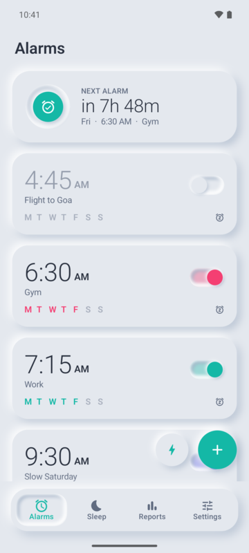
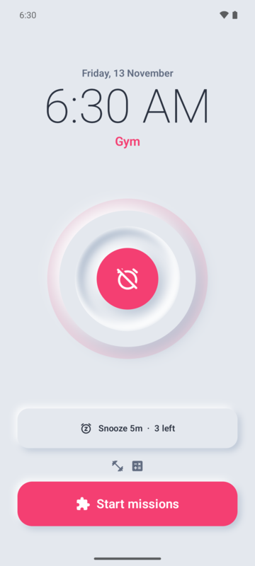
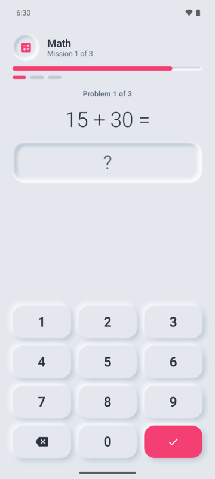
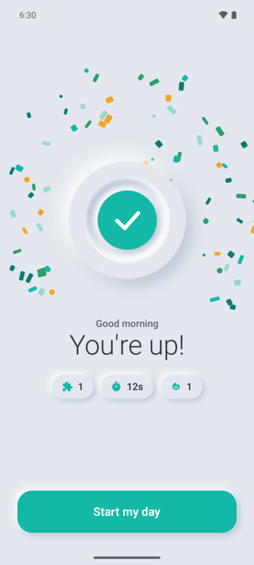
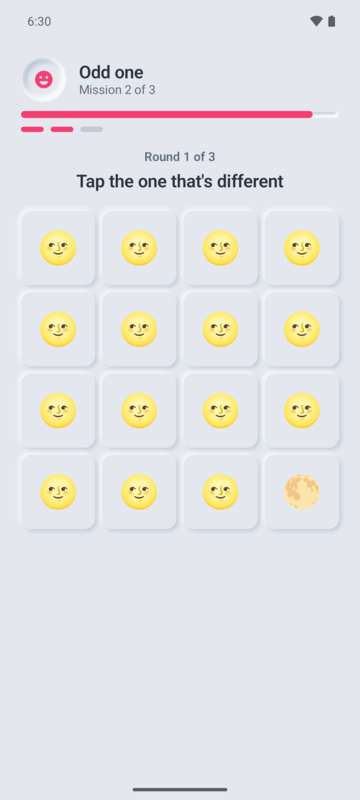
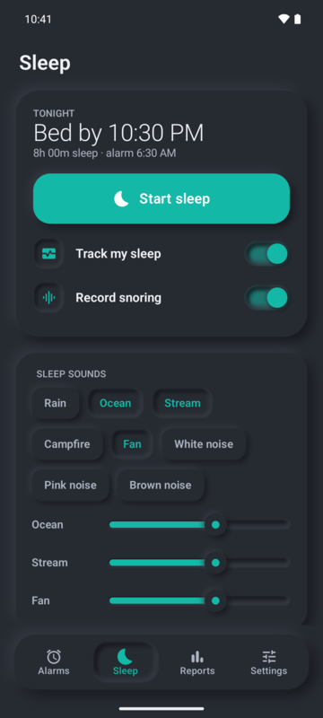
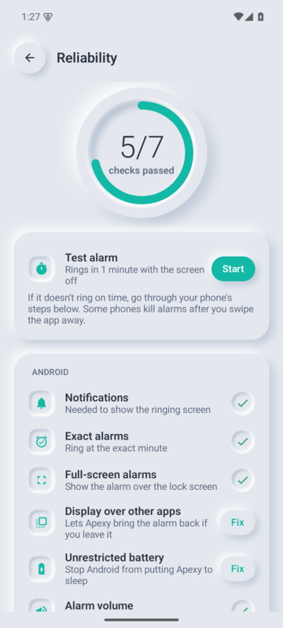

<div align="center">


# Apexy

### Wake up for real.

An alarm clock that won't shut up until you're actually awake.<br/>
No ads. No account. No paywall. No internet. Ever.

[](https://github.com/H-BlaZe/Apexy/releases/latest)
[](LICENSE)
[](#-install-no-tech-skills-needed)
[](https://developer.android.com/compose)
[](#-privacy-not-a-feature-a-rule)
[](CONTRIBUTING.md)

[**Download**](https://github.com/H-BlaZe/Apexy/releases/latest) · [Install guide](docs/INSTALL.md) · [Contribute](CONTRIBUTING.md) · [Support the project](#-support-apexy)

</div>

---

<div align="center">

| 1. Set it | 2. It rings | 3. Prove you're awake | 4. You're up |
|:---:|:---:|:---:|:---:|
|  |  |  |  |

| Spot the odd one | Sleep sounds & tracking | Never miss a ring |
|:---:|:---:|:---:|
|  |  |  |

</div>

---

## ⚡ TL;DR

You set an alarm. It rings. To turn it off you have to **do something**: solve maths, walk 30 steps, scan the QR code you stuck on the bathroom mirror. Snoozing your way to 11 a.m. stops being an option.

Everything other alarm apps hide behind a subscription is free here. Forever. It's open source, so nobody can take it back.

## ✨ What's inside

**⏰ Alarms that actually ring**
- Repeat days, labels, quick nap alarms, skip-next, and a per-alarm accent colour
- Home-screen widget showing your next alarm
- Survives reboots, time-zone changes and the aggressive battery killers on Xiaomi, POCO, Samsung, OnePlus and friends

**🧩 14 wake-up missions**

| Brain | Body | Camera & sensors |
|---|---|---|
| Math · Memory · Typing · Odd one out · In order | Shake · Steps · Squats · Hold steady | QR code · Barcode · Photo match · NFC tag · Light |

Chain up to 5, set a difficulty for each, preview them with "Try it", or pick a random one every morning. An emergency escape is there for real emergencies.

**🛡️ Anti-cheat (for the version of you at 6 a.m.)**
- Snooze limits, shrinking snooze, and a running total of how long you snoozed
- A wake-up check a few minutes after you dismiss it
- Locks on last-minute alarm changes and on the alarm volume
- The alarm screen comes back if you try to leave it
- Gets louder if you ignore it, but never above the speaker limit you set

**🔊 Sound & feel**
- Synthesised tones generated on the device, system ringtones, or your own music
- Gradual volume with an adjustable curve, extra-loud mode, and a spoken message
- Vibration patterns (or tap your own), torch and screen flash

**😴 Sleep**
- Procedurally generated sleep sounds with a mixer and timer
- Motion-based sleep tracking with a night report and sleep stages
- On-device snore detection with clip playback
- Bedtime reminders

**📊 Reports**
- Wake-up streaks, wake-up rate, time to get up, snoozes and consistency
- Daily charts, a per-alarm breakdown and filterable history

**🎨 Looks**
- A hand-built neumorphic design system, in light, dark or system mode
- 8 colour themes or one of your own
- JSON backup and restore, so your alarms move with you to a new phone

## 🔒 Privacy: not a feature, a rule

Apexy has **no internet permission**. Not "we don't collect data". It can't. The permission is stripped from the app at build time, so the APK physically cannot open a network connection.

- No account, no sign-up, no phone number
- No analytics, ads or tracking SDKs
- Snore detection and photo matching run on your phone with bundled models
- Backups are files you choose where to save

You can check this yourself: Android **Settings → Apps → Apexy → Permissions** won't list network access.

## 📲 Install (no tech skills needed)

> Takes about 3 minutes. You don't need a computer.

1. **On your phone**, open the [**latest release**](https://github.com/H-BlaZe/Apexy/releases/latest).
2. Scroll down to **Assets** and tap the file that ends in **`-arm64.apk`**. That's the right one for practically every phone made since 2017.
3. When the download finishes, tap **Open**.
4. If your phone says *"For your security, your phone is not allowed to install unknown apps from this source"*, tap **Settings**, switch on **Allow from this source**, then go back.
5. Tap **Install**. If Google Play Protect warns you, tap **More details → Install anyway**. It does this for any app that isn't on the Play Store.
6. Open Apexy and follow the short welcome screens.
7. Go to **Settings → Reliability** and tap **Fix** on every row that isn't ticked. **Don't skip this step.** It's what stops your phone from killing the alarm overnight.
8. Tap **Test alarm**, lock your phone, and wait a minute. If it rings, you're done. 🎉

Stuck, or on Xiaomi/POCO/Redmi, Samsung, OnePlus, Oppo, Vivo or Realme? The [**full install guide**](docs/INSTALL.md) has step-by-step instructions for each brand, plus how to update and uninstall.

**Updating:** download the new APK and install it over the old one. Your alarms and history stay.

## 💜 Support Apexy

Apexy is free and will stay free. If it got you out of bed and you'd like to say thanks, you can chip in over UPI. Every rupee goes into more testing devices and more late nights on this.

<table>
<tr>
<td align="center">
<br/>
<sub>Scan with any UPI app</sub>
</td>
<td>

**UPI ID**

```
ibnazmat79@okicici
```

Works with Google Pay, PhonePe, Paytm, BHIM, CRED and any bank app.

1. Open your UPI app and tap **Scan QR** (or **Pay to UPI ID**)
2. Scan the code, or paste the ID above
3. Enter any amount you like and pay

Can't donate? A ⭐ on the repo, a bug report or telling a friend helps just as much.

</td>
</tr>
</table>

## 🛠️ Build from source

You'll need JDK 17 or newer and the Android SDK (platform 35). Android Studio sets both up for you.

```bash
git clone https://github.com/H-BlaZe/Apexy.git
cd Apexy
./gradlew testDebugUnitTest assembleDebug
```

The debug APKs land in `app/build/outputs/apk/debug/`: `arm64-v8a` for phones and `x86_64` for the emulator. Install one with:

```bash
adb install -r app/build/outputs/apk/debug/app-arm64-v8a-debug.apk
```

Release builds are signed with a key that lives outside the repo (`keystore.properties`, gitignored). You don't need it to build, run or contribute.

### Project layout

| Path (`app/src/main/java/com/apexy/alarm/`) | What's there |
|---|---|
| `core/` | Scheduling, the ringing service, alarm actions, the anti-cheat lock, backup |
| `data/` | Room database, entities, migrations and DataStore settings |
| `missions/` | Every wake-up mission, the mission runner and mission setup screens |
| `sleep/` | Sleep sounds, the sleep service, sleep analysis, snore detection, bedtime |
| `stats/` | Wake-up sessions, streaks and summaries |
| `ui/neu/` | The neumorphic design system: shadow engine, controls, charts |
| `ui/screens/` | App screens |

More in [CONTRIBUTING.md](CONTRIBUTING.md).

## 🤝 Contributing

Bug reports, translations, new missions, phone-specific reliability fixes: all welcome. Read [CONTRIBUTING.md](CONTRIBUTING.md) first; it's short. Please follow the [Code of Conduct](CODE_OF_CONDUCT.md).

Found a security problem? Don't open a public issue; see [SECURITY.md](SECURITY.md).

## 📜 License

Apexy is free software under the [GNU General Public License v3.0](LICENSE). You can use, study, change and share it. If you distribute a modified version, it has to stay open source under the same license.

Bundled third-party models and libraries keep their own licenses; see [NOTICE.md](NOTICE.md).

<div align="center">
<br/>
<sub>Built with too much coffee and not enough sleep, ironically, by <a href="https://github.com/H-BlaZe">H-BlaZe</a>.</sub>
</div>
